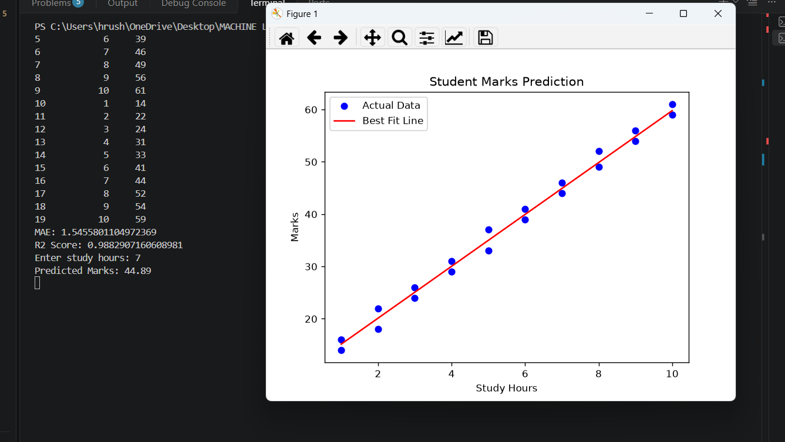
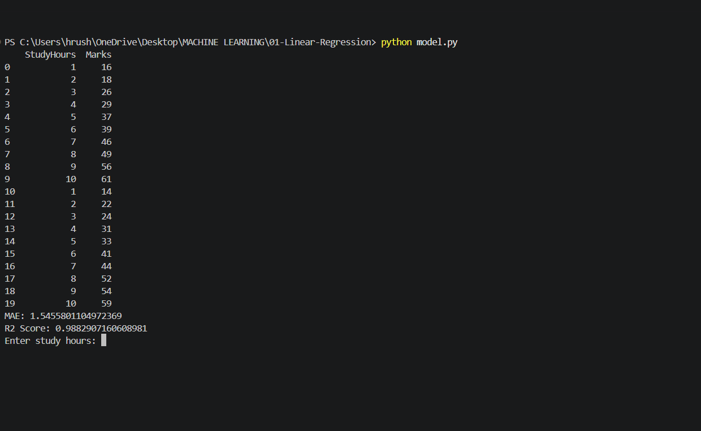

# Student Marks Prediction Using Linear Regression

## Project Overview
This machine learning project predicts student marks based on the number of study hours using Simple Linear Regression.

## Technologies Used
- Python
- Pandas
- Scikit-learn
- Matplotlib

## Project Architecture
Dataset → Data Preparation → Train-Test Split → Model Training → Model Evaluation → Prediction → Visualization

## Dataset
The project uses a synthetic dataset containing 20 student records with study hours and marks.

## Model Performance

| Metric | Result |
|---|---|
| Mean Absolute Error | 1.5456 |
| R² Score | 0.9883 |
| Sample Input | 6 study hours |
| Predicted Marks | 39.93 |

These results are based on a small educational dataset and do not establish real-world reliability.

## How to Run

Install dependencies:

`pip install -r requirements.txt`

Run the model:

`python model.py`

## Output Screenshots

### Regression Graph

### Terminal Output

## Concepts Learned
- Supervised Learning
- Simple Linear Regression
- Best Fit Line
- Train-Test Split
- Model Training
- Model Evaluation
- Prediction and Visualization

## Learning Journey
This is my first Machine Learning mini project as part of my Generative AI learning journey.

